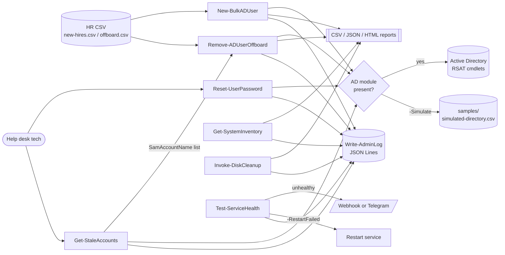

# AdminToolkit: PowerShell help desk & sysadmin toolkit

[](https://github.com/Jparker9204/ps-admin-toolkit/actions/workflows/ci.yml)


[](LICENSE)

A PowerShell module that automates the day-to-day tasks I'd expect on a help desk or junior sysadmin team:
onboarding and offboarding users from HR CSVs, finding stale accounts, password resets, machine inventory,
disk cleanup and service health monitoring with alerts.

Every Active Directory command has a **`-Simulate`** mode backed by a sample directory, so you can demo
the whole toolkit on a laptop, a Linux box or CI with **no domain controller**. Commands that change
things support **`-WhatIf` / `-Confirm`**, and each action writes a **structured JSON log** for auditing.

## Features

| Command | What it does | AD / Simulate | `-WhatIf` | Windows | Linux |
|---|---|:-:|:-:|:-:|:-:|
| `New-BulkADUser` | Onboard users from CSV: unique sAMAccountName, random password, OU, groups, report | ✅ / ✅ | ✅ | ✅ | ✅ (simulate) |
| `Remove-ADUserOffboard` | Disable, strip groups, stamp ticket #, move to Disabled OU, report removed groups | ✅ / ✅ | ✅ | ✅ | ✅ (simulate) |
| `Reset-UserPassword` | Generate a secure password, reset, unlock, force change at logon | ✅ / ✅ | ✅ | ✅ | ✅ (simulate) |
| `Get-StaleAccounts` | Enabled accounts with no logon in *N* days (or never) | ✅ / ✅ | n/a | ✅ | ✅ (simulate) |
| `Get-SystemInventory` | OS, CPU, RAM, disks, uptime, software, NICs to CSV / JSON / HTML | n/a | n/a | ✅ CIM + registry | ✅ /proc + dpkg/rpm |
| `Invoke-DiskCleanup` | User temp, Windows temp, Windows Update cache, Recycle Bin; reports MB freed | n/a | ✅ | ✅ | ✅ (user temp) |
| `Test-ServiceHealth` | Services, TCP ports and URLs; optional restart; webhook / Telegram alert | n/a | ✅ | ✅ | ✅ (systemd) |
| `Write-AdminLog` | JSON Lines audit log used by every command | n/a | always logs | ✅ | ✅ |

## How it fits together



## Quickstart

```powershell
git clone https://github.com/Jparker9204/ps-admin-toolkit.git
cd ps-admin-toolkit
Import-Module ./AdminToolkit -Force
Get-Command -Module AdminToolkit
Get-Help New-BulkADUser -Full        # every command has comment-based help with examples

# Try it with no domain at all:
New-BulkADUser -Path ./samples/new-hires.csv -UpnSuffix contoso.com -Simulate
```

Requirements: Windows PowerShell 5.1 or PowerShell 7.x. Real AD operations need the RSAT
`ActiveDirectory` module and the right delegated permissions; everything else runs anywhere.

Run the same checks CI runs:

```powershell
Install-Module Pester -RequiredVersion 5.7.1 -Scope CurrentUser -SkipPublisherCheck
Install-Module PSScriptAnalyzer -Scope CurrentUser
./build/Invoke-CI.ps1
```

## Usage examples (real output)

All output below was captured on Debian 13 with PowerShell 7.6 by running the commands in this repo
(full transcript: [`docs/sample-output/linux-demo.txt`](docs/sample-output/linux-demo.txt)).

### Onboard new hires from CSV (simulated)

```powershell
New-BulkADUser -Path ./samples/new-hires.csv -UpnSuffix contoso.com -Simulate |
    Format-Table SamAccountName, DisplayName, UserPrincipalName, Status, Message
```
```text
SamAccountName DisplayName    UserPrincipalName     Status    Message
-------------- -----------    -----------------     ------    -------
mgonzalez      Maria Gonzalez mgonzalez@contoso.com Simulated Would create user
jsmith2        James Smith    jsmith2@contoso.com   Simulated Name collision; numbered to jsmith2
apatel         Aisha Patel    apatel@contoso.com    Simulated Would create user
cdubois        Chloé Dubois   cdubois@contoso.com   Simulated Would create user
               Reed                                 Skipped   Missing required column(s): FirstName
```
Against a real domain, drop `-Simulate` and preview first with `-WhatIf`. Accounts are created disabled
with a random 16-character password and *change password at next logon*. Passwords are returned as
`SecureString` and never written to the report or log. Report: [`onboarding-report.csv`](docs/sample-output/onboarding-report.csv).

### Offboard leavers

```powershell
Remove-ADUserOffboard -Path ./samples/offboard.csv -Simulate
```
```text
SamAccountName GroupsRemoved                              Status    Message
-------------- -------------                              ------    -------
bjohnson       Finance-Staff;VPN-Users;SharePoint-Finance Simulated Would disable, remove 3 group(s), move to Disabled OU
kwilliams      Engineering;VPN-Users                      Simulated Would disable, remove 2 group(s), move to Disabled OU
zz-notreal                                                Failed    User 'zz-notreal' not found in simulated directory
```
Accounts are disabled, not deleted, and removed groups are kept in the report, so access can be restored if HR reverses the decision.

### Stale account review

```powershell
Get-StaleAccounts -Days 90 -Simulate | Format-Table
```
```text
SamAccountName DisplayName    Department LastLogonDate       DaysInactive Reason
-------------- -----------    ---------- -------------       ------------ ------
temp-intern    Summer Intern  Operations                                  Never logged on
svc-backup     Backup Service IT         12/01/2025 00:00:00 317          No logon in 90+ days
tmiller        Tom Miller     Marketing  04/15/2026 00:00:00 182          No logon in 90+ days
bjohnson       Bob Johnson    Finance    06/02/2026 00:00:00 134          No logon in 90+ days
```

### Password reset at the help desk

```powershell
Reset-UserPassword -Identity jsmith -Unlock -ShowPassword   # prompts to confirm (ConfirmImpact High)
```

### System inventory

```powershell
Get-SystemInventory -OutputPath ./reports | Select-Object ComputerName, OS, CPU, Cores, MemoryGB, UptimeDays
```
```text
ComputerName : lab-ubuntu-01
OS           : Debian GNU/Linux 13 (trixie)
CPU          : Intel(R) Xeon(R) Processor
Cores        : 8
MemoryGB     : 15.6
MemoryFreeGB : 6.9
UptimeDays   : 0.31

Name FileSystem SizeGB FreeGB PercentFree
---- ---------- ------ ------ -----------
/    ext4       125.00 119.40       95.50

Software packages: 1022
inventory-<host>-<timestamp>.json / .html / -summary.csv / -disks.csv / -network.csv / -software.csv
```
Sample report: [`inventory-sample.html`](docs/sample-output/inventory-sample.html) and [`.json`](docs/sample-output/inventory-sample.json).

### Service / port / URL health with alerting

```powershell
Test-ServiceHealth -ConfigPath ./samples/health-checks.json | Format-Table Type, Target, Status, Detail, ResponseMs
```
```text
Type    Target                            Status    Detail                               ResponseMs
----    ------                            ------    ------                               ----------
Service ssh                               Unhealthy systemctl not available on this host
Service cron                              Unhealthy systemctl not available on this host
Port    github.com:443                    Healthy   TCP connect OK                       13
Port    1.1.1.1:53                        Healthy   TCP connect OK                       0
Port    127.0.0.1:3389                    Unhealthy Connection refused
Url     https://www.powershellgallery.com Healthy   HTTP 200                             228
Url     https://httpbin.org/status/503    Unhealthy HTTP 503                             85
```
(The demo host was a container without systemd, which is why the service rows show as unhealthy. The 503 URL and closed RDP port are deliberate failures.)

Add alerts and auto-restart. The Telegram token comes from an environment variable so it never appears in history or a scheduled task:

```powershell
$env:ADMINTOOLKIT_TELEGRAM_TOKEN = (Get-Secret TelegramBot -AsPlainText)   # e.g. SecretManagement
Test-ServiceHealth -Service Spooler, W32Time -Port 'dc01:389' -RestartFailed `
    -TelegramChatId 123456789 -WebhookUrl $env:TEAMS_WEBHOOK_URL
```

### Disk cleanup

```powershell
Invoke-DiskCleanup -WhatIf | Format-Table Target, FilesFound, MBFound, MBFreed, Status
Invoke-DiskCleanup -Target UserTemp, WindowsTemp, WindowsUpdateCache, RecycleBin -OlderThanDays 14 -Confirm:$false
```
```text
Target      FilesFound MBFound MBFreed Status
------      ---------- ------- ------- ------
UserTemp             0    0.00       0 NothingToClean
WindowsTemp          0       0       0 NotSupportedOnPlatform
RecycleBin           0       0       0 NotSupportedOnPlatform
```

### Structured logs

```powershell
Get-Content $env:ADMINTOOLKIT_LOG | ConvertFrom-Json | Where-Object level -eq 'Warning'
```
```json
{"timestamp":"2026-10-14T05:12:22.8108197Z","level":"Warning","source":"Test-ServiceHealth","host":"lab-ubuntu-01","user":"jparker","message":"Health check: 4 of 7 unhealthy","data":{"unhealthy":4,"total":7}}
```

## Testing & quality

* **Pester 5**: 48 tests. AD cmdlets are stubbed and mocked, so onboarding, offboarding, password resets and stale
  account queries are tested against a fake domain. Filesystem tests run in `TestDrive:`. Windows-only tests
  (CIM, Windows Update service, real services) are skipped automatically on Linux.
* **PSScriptAnalyzer** with [`PSScriptAnalyzerSettings.psd1`](PSScriptAnalyzerSettings.psd1), including
  `PSUseCompatibleSyntax` for 5.1 and 7.4.
* **GitHub Actions** runs the analyzer and Pester on `windows-latest` and `ubuntu-latest`, plus a Windows PowerShell 5.1 job.

Latest local run (Linux, PowerShell 7.6.7): `PSScriptAnalyzer: 0 issue(s)`, `Tests Passed: 45, Failed: 0, Skipped: 3`
([full log](docs/sample-output/ci-run-linux.txt)).

## Project layout

```text
AdminToolkit/
  AdminToolkit.psd1        module manifest (PS 5.1+, Desktop & Core)
  AdminToolkit.psm1        loader
  Public/                  exported commands, one per file
  Private/                 helpers (platform detection, password generator, inventory collectors, health checks)
samples/                   new-hires.csv, offboard.csv, simulated-directory.csv, health-checks.json
tests/                     Pester 5 tests + AD stubs
build/Invoke-CI.ps1        analyzer + Pester, same as CI
docs/sample-output/        real output captured for this README
.github/workflows/ci.yml
```

## Safety notes

* Nothing destructive runs without `ShouldProcess`; offboarding and password resets are `ConfirmImpact = High`.
* No secrets in the repo. Tokens come from environment variables, and passwords are `SecureString` and never logged.
* The sample data uses the fictional `contoso.com` domain.

## What I learned

<!-- TODO (Jonathan): write 3 to 5 bullets in your own words, for example:
- Designing for -WhatIf / ShouldProcess from the start, and why ConfirmImpact matters
- Mocking AD cmdlets in Pester so code can be tested without a domain controller
- Writing PowerShell that runs on both Windows PowerShell 5.1 and PowerShell 7 on Linux
- Structured logging and why audit trails matter for help desk changes
- Setting up a CI matrix in GitHub Actions
-->

_Coming soon._

## License

[MIT](LICENSE) © 2026 Jonathan Parker
